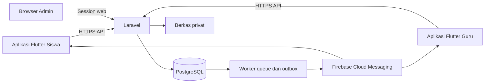

# Arsitektur, API, dan keamanan

[Kembali ke indeks](README.md)

## Struktur sistem



Diagram ini rancangan integrasi, bukan layanan yang sudah dibuat. FCM digunakan untuk push; autentikasi dan data utama tetap Laravel/PostgreSQL.

## Teknologi dan folder yang direncanakan

```text
Civora/
  docs/civora/             indeks, rancangan, dan tugas pengerjaan
  backend/                Laravel: website admin, API, worker, scheduler
  apps/student/           aplikasi Flutter Civora Siswa
  apps/teacher/           aplikasi Flutter Civora Guru
  packages/civora_core/    DTO, API client, session, dan format tanggal
  packages/civora_ui/      token tema dan komponen Flutter bersama
```

- Flutter memakai Material 3 dengan token Civora dan pemisahan fitur/UI/data yang sederhana. Aplikasi punya entry point, identitas package Android, dan distribusi terpisah.
- Laravel melayani API REST berprefix /api/v1 dan website admin dalam deployment yang sama.
- Website admin memakai Blade + Livewire + Tailwind, dengan komponen yang bisa dibangun dari fitur inti tanpa kewajiban lisensi komponen berbayar. Pilihan ini adalah rincian teknis turunan dari keputusan Laravel.
- PostgreSQL menyimpan data bisnis, session, queue, dan cache awal. Redis tidak diwajibkan dalam versi pertama.
- Berkas bukti disimpan pada disk privat server untuk deployment awal; URL publik permanen tidak digunakan.
- FCM HTTP v1 dipanggil worker server, dengan credential server di konfigurasi privat. Kedua aplikasi Android terdaftar sebagai aplikasi berbeda.
- Versi runtime/framework/plugin yang masih didukung diverifikasi dan dikunci saat pengerjaan fondasi. Dokumen tidak mengunci versi semata-mata karena nomor terbaru.

Satu backend modular cukup: modul akun, akademik, katalog poin, pencatatan, pemeriksaan, laporan, notifikasi. Controller/Livewire tidak menggandakan aturan domain; keduanya memanggil action/service yang sama. Tidak ada microservice atau event broker eksternal.

Timezone server/aplikasi adalah UTC. Default timezone tampilan dan tanggal kalender sekolah adalah Asia/Jakarta, melalui school_settings.timezone dengan fallback app.school_timezone. Penulisan datetime PostgreSQL mempertahankan offset/microsecond sehingga DateTime +07 dan timestamp otomatis mewakili instant yang sama setelah dibaca sebagai UTC. Field date akademik mempertahankan tanggal kalender, tidak digeser sebagai timestamp.

## Autentikasi dan sesi

Mobile memakai Laravel Sanctum dengan token per sesi/perangkat, disimpan di penyimpanan aman Android. TTL teknis awal 7 hari, tanpa refresh token buatan sendiri. Login ulang diminta setelah expired; perubahan password/reset/penonaktifan mencabut sesi sesuai dokumen role.

Website admin memakai cookie session Secure/HttpOnly/SameSite dan CSRF protection. Session admin berakhir setelah 30 menit idle. Tindakan password/reset akun administratif memerlukan autentikasi ulang. Hak akses tetap diuji melalui policy/gate untuk setiap resource.

Server selalu memeriksa user aktif dan must_change_password. Token Sanctum yang masih ada tidak mengatasi akun inactive. Tidak ada token/password/QR di query URL, analytics, atau log.

## Bentuk respons API

Keberhasilan memakai data dan meta bila pagination. Kesalahan memakai error.code, error.message, error.fields bila relevan, dan request_id. Timestamp ISO 8601 UTC; server_time dan expires_at disediakan untuk countdown QR.

Status umum: 401 sesi tidak sah, 403 akses ditolak, 404 resource tidak ada/tidak boleh diungkap, 409 konflik versi/penggunaan, 410 resource sementara kedaluwarsa, 422 validasi, 429 pembatasan permintaan, 503 layanan sementara gagal. Pesan pengguna berbahasa Indonesia dan tidak memuat stack trace.

## Kontrak endpoint mobile

| Method dan path di /api/v1 | Role | Perilaku |
| --- | --- | --- |
| POST /auth/student/login | Publik | NISN/password; token dengan role siswa atau mode aktivasi |
| POST /auth/teacher/login | Publik | NIP/kode guru/password; token dengan role guru atau mode aktivasi |
| GET /me | Login | Profil, role, status aktivasi, semester dan penempatan terkait |
| POST /auth/change-password | Login | Password lama/sementara dan baru; akhiri kredensial lama |
| POST /auth/logout | Login | Cabut token sesi ini dan ikatan device token-nya |
| GET /student/summary | Siswa | Dua total, semester, dan status ambang milik sendiri |
| POST /student/qr | Siswa | Token baru; expires_at, server_time; cabut QR lama |
| GET /student/records | Siswa | Riwayat sendiri dengan filter/pagination |
| GET /student/records/{id} | Siswa | Detail sendiri dan status pemeriksaan |
| POST /student/records/{id}/objections | Siswa | Alasan; maksimal satu pending per record |
| GET /teacher/students | Guru | Pencarian siswa aktif, filter kelas/jurusan, pagination |
| GET /teacher/students/{id} | Guru | Profil, total dan penempatan siswa aktif |
| GET /teacher/students/{id}/records | Guru | Riwayat siswa aktif; filter semester/jenis |
| POST /teacher/qr/redeem | Guru | Token QR + request_key; satu selection, retry aman |
| POST /teacher/student-selections | Guru | student_id; server membuat selection manual |
| GET /teacher/point-types | Guru | Jenis aktif dan version_id untuk ringkasan |
| POST /teacher/attachments | Guru | Satu bukti staged privat; validasi file |
| POST /teacher/records | Guru | selection_id, point_type_version_id, description, attachment_id; header Idempotency-Key |
| GET /teacher/record-attempts/{key} | Guru | Cek hasil upaya simpan milik guru ini; bukan milik guru lain |
| GET /teacher/records | Guru | Catatan buatan guru login |
| GET /teacher/records/{id} | Guru | Detail catatan siswa aktif atau catatan buatan sendiri pada siswa nonaktif; koreksi dibatasi pemilik |
| POST /teacher/records/{id}/correction-requests | Guru | Alasan dan usulan perubahan; hanya catatan sendiri |
| POST /teacher/students/{id}/temporary-credential/reveal | Guru | Body current_password guru; password sementara belum aktivasi; audit dan autentikasi ulang |
| GET /notifications | Siswa/guru | Daftar milik sendiri |
| POST /notifications/{id}/read | Siswa/guru | Tandai milik sendiri dibaca |
| POST /device-tokens | Siswa/guru | Daftarkan token push untuk aplikasi/role yang sesuai; server mengikat sesi Sanctum saat ini |
| DELETE /device-tokens/{id} | Siswa/guru | Cabut token perangkat milik sendiri |
| GET /attachments/{id} | Login | Streaming privat setelah policy atas catatan/revisi atau staged owner |

### Bentuk respons profil, ringkasan, dan riwayat

GET `/me` mengembalikan `data` identitas dasar. Untuk akun aktif, siswa juga menerima `student`, `enrollments`, `current_semester`, `own_enrollment`, dan `school_timezone`; `own_enrollment` berisi ID penempatan serta kelas dan jurusan saat ini, atau `null` bila belum ada penempatan yang berlaku. Guru aktif menerima `teacher`, `current_semester`, dan `school_timezone`. `school_timezone` adalah nama zona waktu IANA dari pengaturan sekolah tersimpan (fallback konfigurasi server Asia/Jakarta). Akun yang masih menunggu aktivasi menerima identitas dasar saja.

GET `/student/summary` mengembalikan `data.semester`, `data.totals` (`achievement` dan `violation`), serta `data.latest_threshold_status` untuk kebijakan ambang terbaru. Jika semester aktif tidak tersedia, ketiganya bernilai `null`; klien tidak menampilkan angka nol seolah-olah tersedia.

Riwayat siswa dan guru memakai `PointRecordResource` di setiap elemen `data`, dengan `meta.current_page`, `meta.last_page`, `meta.per_page`, `meta.total`, dan `meta.available_semesters`. Tiap pilihan semester berisi `id`, `name`, `start_date`, `end_date`, dan `is_current`. Filter yang didukung ialah `semester_id`, `category` (`achievement` atau `violation`), `status` (`active` atau `cancelled`), `page`, dan `per_page`. Pilihan semester mencakup riwayat yang boleh dibaca pemanggil serta semester aktif.

GET `/teacher/students` menambahkan `meta.filters.classrooms` (ID dan nama) dan `meta.filters.majors` (ID, nama, dan kode). Pilihan hanya berasal dari kelas dan jurusan aktif pada tahun ajaran semester aktif, termasuk saat halaman hasil pencarian kosong.

POST keberatan siswa menerima hanya `reason`; respons `data` berisi ID permintaan, ID catatan, `kind`, `reason`, `proposed_change` kosong, `status`, `reviewed_revision`, dan `created_at`. Permintaan koreksi guru memiliki bentuk yang sama dengan usulan eksplisit pada `proposed_change`: `operation` (`cancel` atau `revise`), dan untuk koreksi dapat menyertakan `point_type_version_id`, `description`, atau `attachment_id`. Respons keduanya berstatus pending; usulan tidak mengubah total sampai admin menyetujuinya.

Endpoint admin tidak diwajibkan sebagai API publik terpisah. Livewire memakai session dan action server untuk pengelolaan data, import, pemeriksaan, ambang, tindakan, laporan, serta akun.

Body POST /teacher/records tidak menerima teacher_id, student_id, points, semester_id, atau status dari klien sebagai sumber kebenaran. Informasi tersebut diambil dari user, selection, katalog, dan semester server.

## QR dan retry scan

Token QR dihasilkan secara kriptografis, 32 byte acak dalam format URL-safe, dengan prefix versi agar kamera dapat mengenali payload. Hash token disimpan di database; token mentah hanya dikembalikan kepada siswa yang login, dengan response no-store.

Redeem memakai transaction dan row lock dengan urutan global pada dokumen 05. Permintaan pertama valid membuat selection dan redemption. Retry dengan request_key/token/guru yang sama mengembalikan hasil yang sama, tanpa mengonsumsi token dua kali. Guru lain atau request_key berbeda mendapat penolakan token terpakai. Jika semester/siswa berubah setelah scan, selection tidak mengizinkan simpan.

QR tidak berisi NISN, password, nilai poin, atau tautan yang dapat mengubah data tanpa login guru. Validitas mengikuti waktu server, bukan waktu HP. Tidak ada grace period untuk screenshot kedaluwarsa. QR yang diterbitkan oleh sesi/token login yang sudah dicabut juga ditolak, sekalipun batas 20 detiknya belum habis.

## Konsistensi dan idempotensi

Server memeriksa kunci idempotensi sebelum menganggap selection yang sudah dikonsumsi sebagai kesalahan. Jika kunci cocok dan payload identik, hasil sukses lama dikembalikan. Jika berbeda, server mengembalikan IDEMPOTENCY_CONFLICT.

Perubahan katalog, penempatan, atau semester menghasilkan konflik yang meminta guru membaca data terbaru. Aplikasi mempertahankan keterangan, tetapi meminta konfirmasi ringkasan ulang. Permintaan pencatatan harus melalui HTTPS dan memakai validasi whitelist field.

## Berkas dan import

- Bukti: satu JPG/PNG maksimal 5 MB; periksa isi/MIME, decode gambar, buang metadata lokasi, dan simpan dengan nama internal.
- Foto staged hanya dapat dipakai oleh guru yang mengunggah dan satu catatan. Lampiran yatim dibersihkan terjadwal.
- Lampiran dan laporan tidak dapat diakses melalui path storage publik; policy berlaku pada setiap unduhan.
- Import: XLSX/CSV UTF-8, 10 MB, 5.000 baris; cegah file terkompresi yang mengembang berlebihan, formula executable, dan HTML aktif.
- Pratinjau disimpan sebagai batch milik admin yang mengunggah. Konfirmasi memvalidasi ulang untuk mencegah perubahan referensi setelah preview.
- Ekspor XLSX memperlakukan teks masukan sebagai teks; PDF merender teks yang di-escape, bukan HTML dari pengguna.

## Notifikasi

Event utama: poin dibuat, keputusan keberatan/koreksi, revisi/pembatalan, dan ambang tercapai. Penerima siswa adalah pemilik catatan. Guru pencatat menerima keputusan permintaan/koreksi dan perubahan catatannya. Admin melihat antrean pending serta peringatan pada website.

Notification dan outbox ditulis bersama perubahan bisnis. Worker membuat push dengan pesan umum dan resource ID; ketika diklik, aplikasi meminta detail melalui sesi login. Jika push gagal atau izin notifikasi ditolak, notifikasi in-app tetap tersedia. Retry dengan event_key sama tidak menggandakan notifikasi.

Token push lama yang tidak valid dicabut; token perangkat yang berpindah pengguna dilepas dari pemilik lama. ID sesi perangkat diambil dari token autentikasi server, tidak diterima dari body. Logout mencabut ikatan perangkat sesi saat ini; reset/penonaktifan mencabut seluruh perangkat pengguna. Kegagalan FCM tidak membatalkan pencatatan poin yang sudah commit.

## Referensi teknis

- [Arsitektur Flutter](https://docs.flutter.dev/app-architecture)
- [Material untuk Flutter](https://docs.flutter.dev/ui/design/material)
- [Laravel starter kits](https://laravel.com/framework/docs/13.x/starter-kits)
- [Laravel Sanctum](https://laravel.com/framework/docs/13.x/sanctum)
- [Laravel queues](https://laravel.com/framework/docs/13.x/queues)
- [Firebase Cloud Messaging untuk Flutter](https://firebase.google.com/docs/cloud-messaging/flutter/get-started)
- [OWASP transaction authorization](https://cheatsheetseries.owasp.org/cheatsheets/Transaction_Authorization_Cheat_Sheet.html)

Referensi adalah dukungan teknis, bukan penggantian keputusan produk Civora. Aturan umur QR, hak guru, dan semester berasal dari brainstorming.
